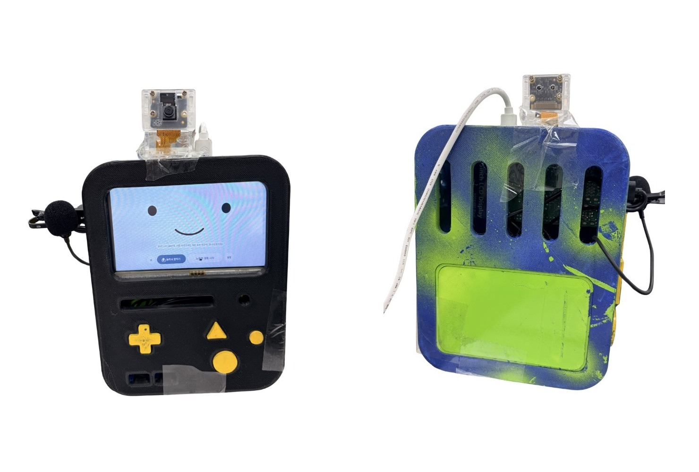
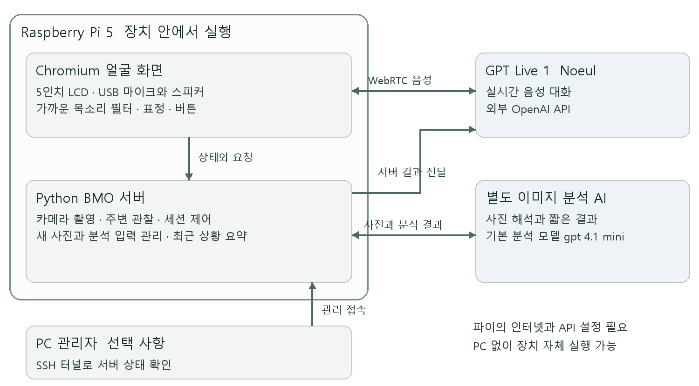

# BMO 카메라와 실시간 음성으로 대화하는 개인 AI 비서

라즈베리파이 5와 5인치 LCD로 만든 BMO 형태의 개인 AI 비서입니다. USB 마이크·스피커로 대화하고, 카메라로 확인한 주변 상황을 답변에 연결합니다. 대화 시작 버튼을 한 번 누른 뒤 음성을 주고받는 방식과 기존 눌러서 말하기를 함께 제공합니다.



개발자 최승빈 · 기록 기준 2026년 10월 22일 · 개인 제작 시제품

## 만들게 된 계기

우연히 BMO를 개인 AI 비서로 만드는 영상을 보았습니다. 여기에 카메라를 붙이고, 매번 버튼을 누르는 대화에서 실시간 대화로, 더 나아가 상황을 보고 먼저 말을 거는 비서로 발전시켜 보고 싶었습니다.

제작 중 가장 오래 고민한 문제는 참고 설계도와 실제 부품의 차이였습니다. 같은 5인치 화면을 사용해도 파이 모델과 USB 커넥터가 차지하는 공간은 달랐습니다. 케이블을 넣기 위해 본체 일부를 인두기로 직접 가공했던 과정까지 [개인 프로젝트 보고서](docs/PROJECT_REPORT.md)에 담았습니다.

## 현재 기능

- **실시간 음성 대화:** `gpt-live-1`과 한국어 음성 `noeul`을 사용합니다. 기존 STT → 답변 생성 → TTS 방식의 눌러서 말하기도 유지합니다.
- **현재 장면 질문:** 파이 카메라의 사진을 별도 이미지 분석 AI가 해석하고, 그 결과를 노을의 음성 답변으로 전달합니다.
- **요청마다 새 촬영:** “사진 찍어줘”, “다시 찍어줘”는 요청 후 새 사진 한 장을 분석합니다. 실패하면 이전 사진을 대신 사용하지 않습니다.
- **주변 관찰과 먼저 말하기:** 메모리에서 장면 변화를 확인하고 필요한 때만 분석합니다. 의미 있는 변화에 한해 조용한 틈에 짧게 안내하도록 구성했습니다.
- **표정과 설정:** 12개 감정에 여러 표정을 연결합니다. Rosto 1~25번 중 15번을 제외한 24장을 사용하며, 생각 중 표시와 마이크·스피커 음량 설정을 제공합니다.

이 버전의 Live 음성 프런트엔드에는 이미지를 직접 보내지 않습니다. 이미지는 별도 분석 백엔드가 처리합니다. 이 구분은 [OpenAI의 위임 문서](https://developers.openai.com/api/docs/guides/live-delegation#add-images-and-visual-context)에 따릅니다.

## 동작 구조



파이에서 Python 서버와 Chromium 얼굴 화면을 함께 실행합니다. 설정 후에는 PC를 켜지 않아도 동작하지만, 파이의 인터넷 연결과 API 이용 설정은 필요합니다. PC는 개발·관리용이며 SSH 터널로 관리자 화면에 접속할 수 있습니다. `/phone`은 초기 이름이 남은 화면 경로로, 지금은 파이 LCD에서도 같은 화면을 사용합니다.

## 사용한 장치

- Raspberry Pi 5, Raspberry Pi OS 데스크톱
- MPI5008 5인치 HDMI LCD, 800×480, GPIO 터치
- Camera V2 계열 IMX219, CAM/DISP 0
- JBC-055 USB 마이크, USB 스피커
- 3D 출력·도색한 BMO 본체와 연결 케이블

Fusion 설계와 3D 출력, 부품 배치, 도색, 조립 과정을 거쳤습니다. 스피커의 제품 모델명과 최종 제작비는 기록이 충분하지 않아 확정하지 않았습니다.

## 실행

아래 명령은 **BMO 소스코드가 있는 프로젝트 루트**에서 실행합니다. 최초 설치와 장치별 설정은 [설치 안내](docs/SETUP.md)를 따릅니다.

```bash
# 파이에서 카메라와 주변 관찰을 사용하는 노을 버전
bash start-pi-live-noeul.sh --auto-camera --observe --pc-port 8775
```

파이 브라우저에서 `http://127.0.0.1:8765/phone`을 엽니다. 관리자 화면은 같은 서버의 `/admin`입니다. 기존 자동 실행 설정이 되어 있다면 서비스와 중복 실행하지 않습니다.

1. **노을과 대화 시작**을 누르고 브라우저의 마이크 사용을 허용합니다.
2. “지금 카메라에 뭐가 보여?”로 장면 답변을 확인합니다.
3. 카메라 방향이나 물건을 바꾼 뒤 “사진 다시 찍어줘”를 요청합니다.
4. 설정에서 관찰 상태, 최근 요약과 음량을 확인하고, 사용 후 대화를 종료합니다.

## 확인한 범위와 남은 과제

2026년 10월 22일 검증 기록에는 Python 141개 검사(PC·파이), JavaScript 61개 검사(PC), 실제 파이 카메라와 노을 세션을 연결한 새 촬영 요청 2회가 기록되어 있습니다. **이 수치는 테스트 개수이며 대화·인식 정확도를 뜻하지 않습니다.** 상세 내용은 [검증 기록](docs/VALIDATION.md)을 참고하세요.

공개 저장소를 준비하면서 개인 설정 파일이 없는 환경의 키 읽기 오류를 수정하고 회귀 검사를 추가했습니다. 공개용 복사본에서 **Python 144개와 JavaScript 61개**를 PC에서 다시 확인했습니다. 이 추가 수정은 이번 작업에서 파이에 재배포하지 않았습니다.

```bash
python -m unittest discover -s tests -q
node --test tests/*.cjs
```

가까운 목소리 우선 기능은 크기·지속 시간을 이용한 필터입니다. 화자 신원을 구별하지 않으며 큰 주변 목소리는 통과할 수 있습니다. 프로액티브 기능의 조건 제어는 검사했지만, 실제 생활에서 유용한 시점에 말하는지는 장시간 사용 평가가 더 필요합니다. 호출어로 시작하기, 사용자 추종 주행과 장애물 회피는 아직 구현하지 않았습니다.

사진은 여러 정지 프레임을 활용하며 연속 동영상을 이해하는 기능은 아닙니다. 음성과 필요한 사진은 외부 API로 전송됩니다. 서버 API 키와 개인 촬영 자료는 공개 문서에 넣지 않았습니다.

## 제작 과정 읽기

- [개인 프로젝트 보고서](docs/PROJECT_REPORT.md) — 시작 계기부터 실제 제작과 설계 선택까지
- [개발일지](docs/DEVELOPMENT.md) — 날짜별 작업과 방향을 바꾼 이유
- [핵심 코드 해설](docs/KEY_CODE.md) — CodeSnap 이미지 6장과 복사 가능한 실제 코드
- [설치와 네트워크](docs/SETUP.md) · [검증과 한계](docs/VALIDATION.md)
- [사진 출처와 참고 자료](docs/CREDITS.md)
- [이전 버전과 원래 작업 기록](docs/ARCHIVE.md)

AI는 코드 작성·수정, 오류 분석과 문서화를 도왔습니다. 목표와 우선순위 결정, 출력·도색·배선·기구 가공, 실제 장치 시험과 피드백은 개발자가 수행했습니다. 역할과 판단 과정은 보고서에 따로 기록했습니다.
