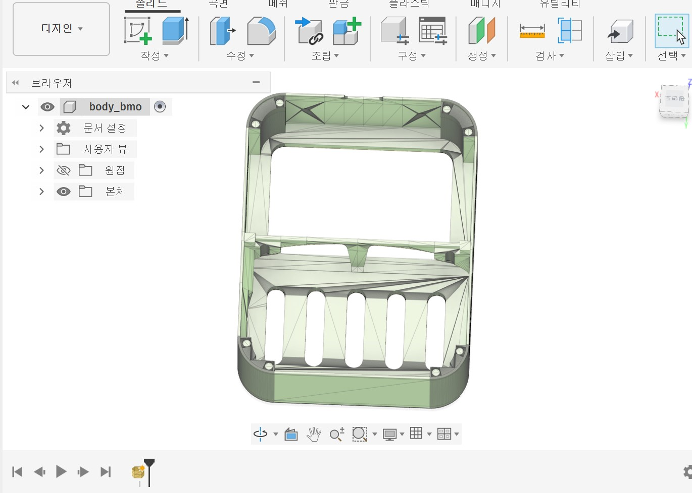
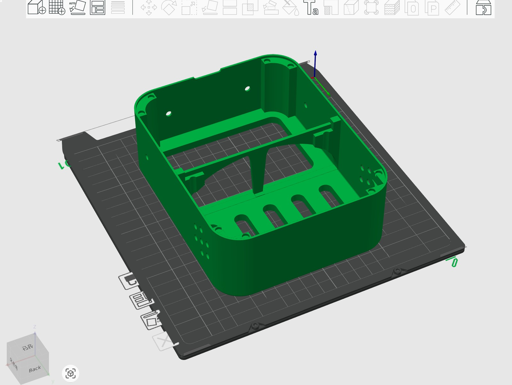
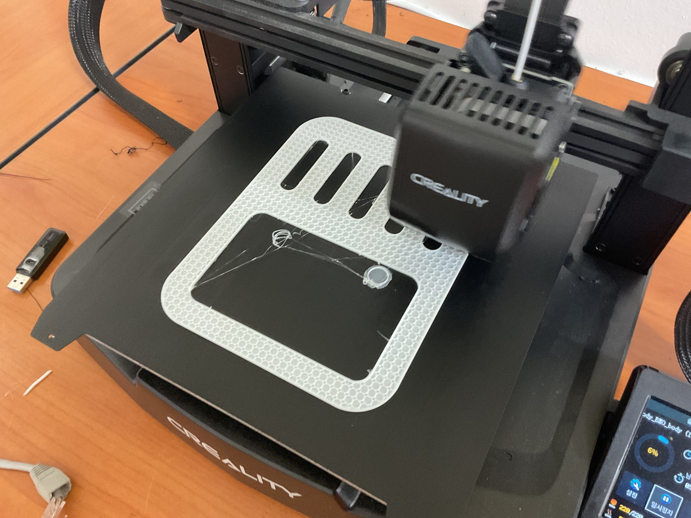
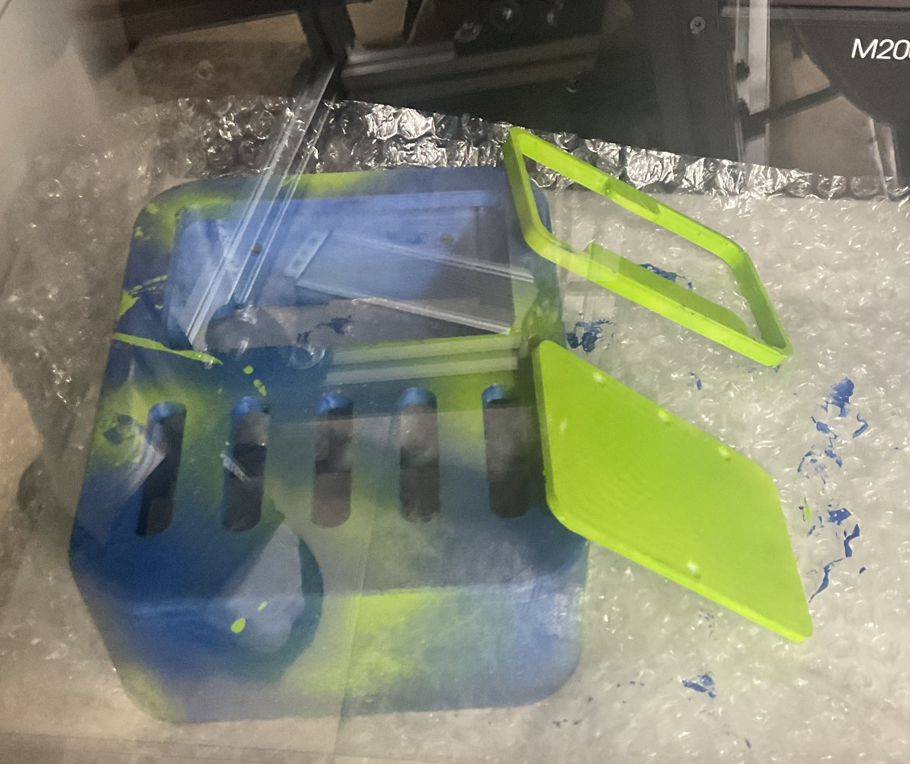
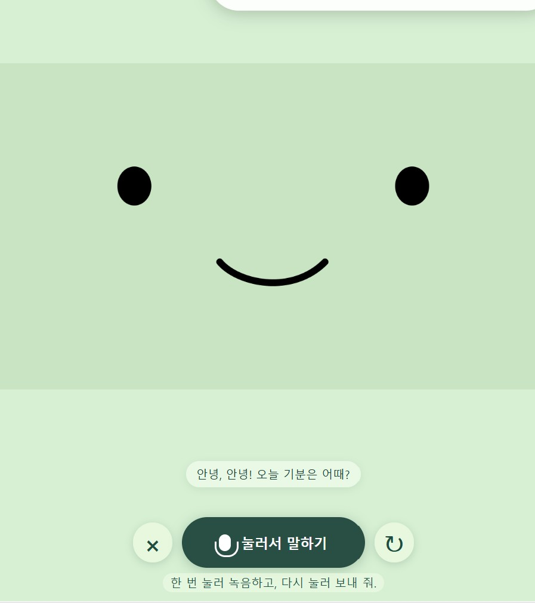
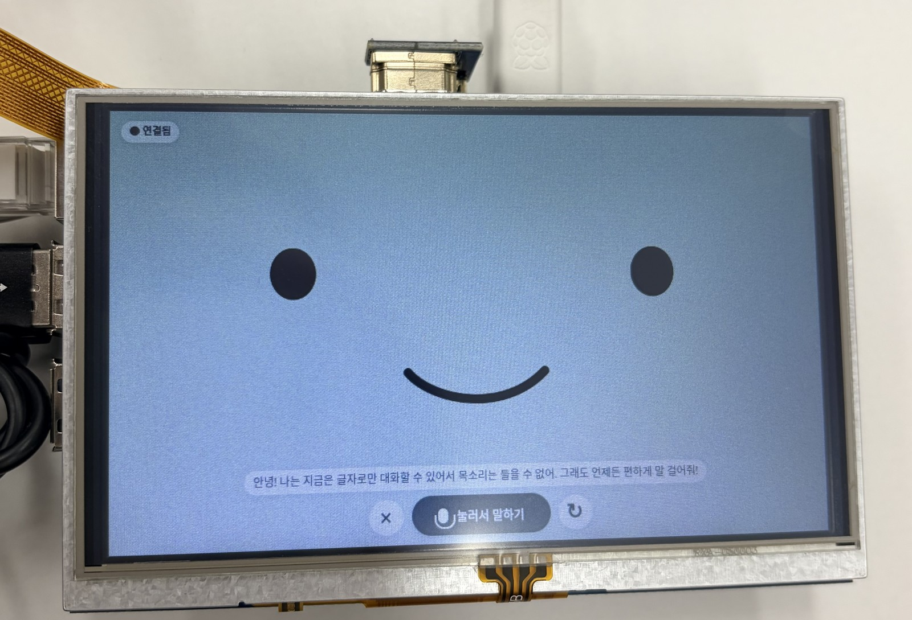

# BMO 개발일지

작성 최승빈 · 2026년 10월 22일 정리

이 기록은 기능이 추가된 순서와, 기존 계획을 바꾸게 된 이유를 함께 남긴다. 초기 제작 날짜는 기존 보고서의 일지를, 소프트웨어 수정과 검증 날짜는 프로젝트의 버전·검증 기록을 기준으로 했다. 날짜가 없는 대화 내용을 임의의 날짜로 배정하지 않았다.

## 시작 계기

우연히 BMO를 개인 AI 비서로 만드는 영상을 보았다. 원형의 외형과 대화하는 장치라는 아이디어가 출발점이었다. 나는 여기에 카메라를 붙여 주변을 보고 대화하게 하고 싶었다. 매번 눌러서 말하는 방식보다 실시간으로 주고받고, 다음에는 먼저 상황을 알아채는 비서에 가까워지는 것을 목표로 삼았다.

이 목표가 처음부터 완성된 설계로 주어진 것은 아니었다. 실제 부품을 연결하고 써 보면서 화면, 음성, 카메라의 역할을 나누고 기능의 우선순위를 정했다.

## 8월 20일 초기 외형과 내부 구조 구상

외형과 내부 부품 배치를 구상하고 필요한 부품을 정리했다. 처음에는 사용자 추종을 위한 모터·바퀴도 후보에 넣었다. 지금 남아 있는 길쭉한 기구 도면과 이동부 배치는 이 단계의 계획이다. 최종 시제품에서 주행을 구현했다는 뜻은 아니다.

초기 구상을 모두 한 번에 구현하기보다 고정된 장치에서 화면·음성·카메라가 함께 동작하는 것을 먼저 확인하는 방향으로 범위를 정리했다.

## 8월 27일 본체 설계와 출력 준비

Fusion에서 본체 구조를 확인하고 STL 출력 준비를 진행했다. 인터넷에서 받은 설계 자료를 참고했지만, 내가 가진 부품과 그대로 맞는지는 별도의 문제였다. 특히 파이와 디스플레이 사이의 거리, USB 커넥터가 몸체 밖으로 나오는 방향을 실제 조립에서 확인해야 했다.

## 9월 3일 출력과 부품 배치

3D 출력과 조립을 진행하면서 내부 공간을 확인했다. 화면 크기가 같더라도 보드의 종류, 포트 위치, 꽂힌 케이블까지 포함한 공간은 달랐다. 이후 가장 오래 고민하게 된 구조 문제는 이 차이와 연결되어 있었다.

## 9월 10일과 17일 도색과 초기 파이 연동

출력 부품을 도색하고 본체 조립을 이어 갔다. 초기 기록에는 파이 4 환경을 시험한 내용이 있으며, 최종 구성은 파이 5로 정리되었다. 이 시기의 사진은 외형 제작 과정을 보여 주며 최종 음성 모델의 작동 증거와는 구분한다.

파이와 PC의 연결도 반복해서 확인했다. 유선 연결로 설정을 진행하고 무선 사용으로 옮기는 과정에서, 파이 접속 주소와 AI API가 사용하는 인터넷 연결을 서로 다른 조건으로 이해할 필요가 생겼다. 초기 무선 연결 실패의 정확한 원인은 기록만으로 확정하지 않았다.

## 10월 8일 웹 대화 화면과 본체 조립

AI API를 이용한 음성 대화와 브라우저 얼굴 화면을 시험했다. 처음에는 휴대폰을 본체 안에 넣고 화면·마이크·스피커로 활용하려 했지만 실제 크기가 맞지 않았다. 이미 만든 웹 화면은 유지하고 표시 장치를 5인치 LCD로 바꾸는 쪽을 선택했다.

**날짜를 특정하지 않은 기구 수정:** 설계도와 내 자원이 달랐고, 파이 모델과 USB 선을 수납할 공간 확보가 어려웠다. 나는 인두기로 본체 일부를 직접 가공해 필요한 공간을 만들었다. 가장 기억에 남는 작업이다. 위 사진은 조립 기록이며 인두 가공 순간을 촬영한 사진은 아니다.

## 카메라를 연결하며 확인한 센서와 포트

처음에는 카메라를 Rev 1.3으로 알고 설정했고 CAM/DISP 포트도 바꾸어 확인했다. 연결 사진에서 Camera V2 표기를 확인한 뒤 실제 센서인 IMX219와 CAM/DISP 0에 맞춰 설정했다. 명칭을 추측하는 대신 실제 보드 표기와 장치 인식 결과를 근거로 바꾼 사례였다.

촬영이 성공한 뒤에도 처음 프레임에는 사물 윤곽이 거의 없었다. 렌즈 주변과 거리를 확인하고 방향을 바꾼 뒤 장면이 선명하게 들어왔다. 장치 인식 성공, 이미지 수신 성공, 쓸 만한 이미지 확보는 각각 따로 확인해야 했다. 이 과정의 정확한 날짜는 대화 기록만으로 정하지 않았다.

## 10월 15일 LCD 터치와 음성 입출력

MPI5008에서 바탕화면은 보였지만 터치가 되지 않았다. 화면 전송과 터치 입력을 나누어 확인하고 GPIO 터치 설정을 적용했다. 기존 화면·카메라 설정을 보존하는 도구와 검사 후 재부팅했으며, 직접 터치 인식을 확인했다.

LCD 모서리는 누르기 어려웠다. 실시간 대화 버튼을 눌러서 말하기 옆 중앙으로 옮기고, 설정에서 마이크와 스피커 음량을 조절하도록 했다. 스피커는 처음 테스트 소리가 들리지 않거나 작게 들렸으므로 출력 장치 선택과 실제 청취 확인을 거쳤다.

## 10월 15일 자동 대화 실험과 롤백

내가 원한 자동 시작은 “시리야”처럼 호출하면 대화가 시작되는 방식이었다. 당시 자동 대화 실험은 이 의도와 맞지 않아 별도 버전으로 보관하고 되돌렸다. 생각하는 표정과 “생각 중 …”는 유지했다.

이후 기존 실시간 대화 버튼을 복원했다. 버튼 한 번으로 세션을 시작하고 대화 안에서는 매번 누르지 않는 방식이다. **현재도 호출어 인식이 구현된 것은 아니다.** 실험을 분리해 보관한 이유는 무엇을 되돌렸고 무엇을 유지했는지 구분하기 위해서였다.

## 10월 15일 감정에 맞는 여러 표정

표정 파일은 많았지만 실제로 보이는 표정은 제한적이었다. 나는 답변 감정을 정해 둔 한 단어로 분류하고, 같은 감정에도 여러 이미지를 연결해 보고 싶었다. 동시에 표정이 계속 바뀌어 산만해지지 않도록 기본 상태 변화는 유지해 달라고 요청했다.

최종 매핑은 12개 감정과 24개 이미지다. 1~25번 중 15번을 제외하고, 직전 표정을 피해서 무작위로 고른다. 한 답변 동안 선택한 포즈를 유지하고 대기·듣기·생각 중 상태는 따로 처리한다. 사람의 감정을 카메라로 추정하는 기능과는 다르다.

## 10월 16일 주변 관찰과 프로액티브 기능

처음에는 질문할 때만 사진을 쓰는 방향을 생각했지만, 이후에는 대화하지 않을 때도 주변을 관찰하고 더 자율적으로 먼저 말을 거는 방향을 선택했다. 모든 사진마다 발화하면 시끄럽고 반복적일 수 있어 관찰과 말하기 조건을 분리했다.

로컬에서 약 1초 간격으로 프레임을 확인하고 안정된 변화 등을 분석한다. 분석 간격·시간당 한도를 두고, 실제 안내에는 4초의 조용한 틈과 3분 간격·시간당 6회 한도를 추가했다. 처음 본 장면과 단순 조명 변화에는 먼저 말하지 않는다. 이러한 조건은 자동 검사했으며 실제 생활에서의 유용성은 장시간 시험 과제로 남겼다.

## 10월 21일 노을 버전 분리

기존 실시간 계열을 남긴 채 GPT-Live-1과 한국어 음성 노을 버전을 따로 준비했다. 음성 대화와 이미지 분석의 경로도 분리했다. 이미지 자체는 별도 분석 AI로 보내고 그 결과를 노을에게 전달하는 구조다. 공식 문서에서도 Live 음성 프런트엔드의 이미지 입력과 백엔드 시각 분석을 구분한다. [위임 문서](https://developers.openai.com/api/docs/guides/live-delegation#add-images-and-visual-context)

이 날짜의 PC 검사는 모의 검사 중심이었다. 실제 파이 배포와 음성·카메라 연결 확인은 다음 날 진행했으므로, 준비와 현장 검증을 같은 단계로 쓰지 않았다.

## 10월 22일 근접 입력과 장면 정보 통합

주변 사람의 소리에 BMO의 말이 끊기는 문제가 있었다. 마이크에 입을 가까이 대고 말하는 사용 방식에 맞춰 크기와 지속 시간으로 입력을 거르는 필터를 적용했다. 처음 음절을 살리는 선행 버퍼와 약한 후속 음절을 유지하는 조건도 보완했다. 음성 지문으로 내 목소리만 구별하는 방식은 아니다.

파이에 노을, 관찰, 근접 입력을 함께 적용하고 실제 API 경로를 확인했다. 고정 합성 인사와 카메라 질문을 보내 음성 응답과 장면 설명을 확인했다. 합성 입력 시험이므로 실제 내 목소리와 모든 소음 환경에서 같은 결과가 나온다고 해석하지 않았다.

## 10월 22일 이전 사진을 반복하는 문제 수정

“사진을 다시 찍어 달라”고 했는데 이전 장면을 계속 설명했다. 촬영 버튼이나 프롬프트만의 문제가 아니었다. 관찰 프레임·업로드 사진·이전 요약이 새 요청에 섞이는 경로를 분리해야 했다.

명시적 사진 요청은 요청 이후 새 노출을 받고, 그 한 장만 분석하도록 바꾸었다. 실패하면 옛 사진을 대신 쓰지 않는다. 모델이 촬영을 말로 수락하고 분석 위임을 빠뜨린 경우에는 서버 자막으로 요청을 확인한다. 중복 위임은 합치고 취소된 작업의 늦은 결과는 버린다. [핵심 코드](KEY_CODE.md)에 이 흐름을 실제 소스로 남겼다.

최종 기록은 PC·파이 Python 141개, PC JavaScript 61개 통과다. 실제 파이와 노을을 연결해 새 촬영을 두 번 요청했고 촬영 번호와 시각이 바뀌며 요청별 분석 1회가 처리된 것을 확인했다. 첫 응답에는 결과 전 짧은 설명 조각도 있었으므로, 모델 발화까지 완벽해졌다고 쓰지는 않았다.

## 다음에 확인할 일

실제 내 목소리와 주변 대화가 함께 있는 상황에서 끼어들기와 음절 손실을 비교하고 싶다. 프로액티브 기능도 장시간 사용하며 도움이 된 안내와 방해가 된 안내를 구분할 필요가 있다. 기구를 다시 설계한다면 보드 크기뿐 아니라 USB 플러그, 케이블이 휘는 공간, 정비를 위해 열어야 하는 방향까지 처음부터 확인할 것이다.

호출어, 주행, 장애물 회피는 다음 단계다. 지금의 결과는 고정형 BMO에서 얼굴·음성·카메라를 연결한 시제품이며, 그 과정에서 직접 겪은 부품 배치와 입력 시점의 문제를 기록하는 것이 이 일지의 목적이다.

## 10월 22일 공개 문서와 저장소 준비

수행평가 보고서와 별도로 개인 README·개발일지·보고서를 만들었다. 제작 계기와 USB 공간을 직접 가공했던 경험을 중심으로 과정을 재구성하고, 실제 코드 6개를 CodeSnap 렌더러로 이미지화했다. 기존 사진 15개를 보존한 사본과 실제 사용 표정 24장의 목록, 통신 구조도를 함께 정리했다.

공개용 소스에서 개인 API 키 파일을 제외하고 검사를 다시 실행하자, 파일이 없을 때 환경 변수로 키를 읽지 못하던 오류가 드러났다. 이를 수정하고 회귀 검사 3개를 추가해 PC Python 144개·JavaScript 61개를 확인했다. 이전 버전의 시험 결과와 이번 공개 준비 검사는 구분했다. 저장소는 현재 소스와 과거 버전 10개를 모으되 실제 키·인증서·개인 촬영 시험 자료를 제외하는 구성으로 정리했다.
