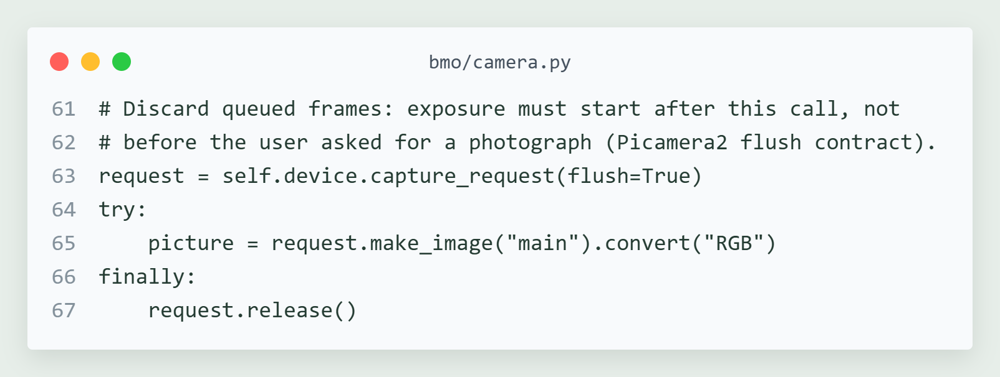
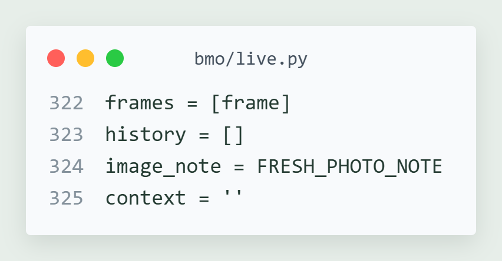
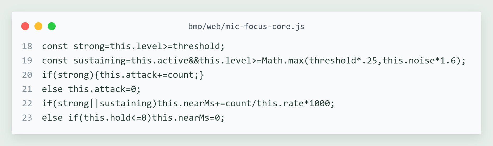
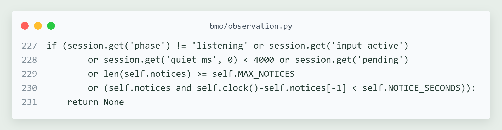
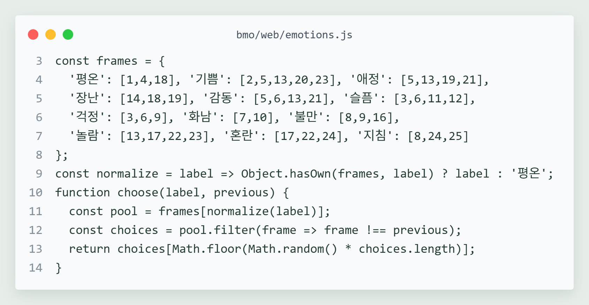
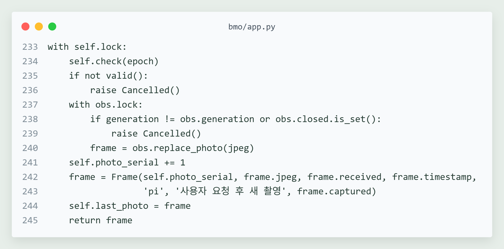

# BMO 핵심 코드 해설

2026년 10월 22일 실제 소스에서 발췌했다. 이미지와 복사 가능한 코드의 내용은 같다. 공통 들여쓰기는 이미지 표시에서만 제거했다. 각 조각은 설명용 발췌이며 독립 실행 예제가 아니다.

## 대기 프레임을 버리고 새 노출 받기

촬영 요청 이후 노출을 받기 위해 flush=True를 사용한다. JPEG 변환 뒤에는 finally에서 request를 반환한다.

원본 `bmo/camera.py` 61~67행. [발췌 파일](snippets/01-fresh-exposure.py)



```python
            # Discard queued frames: exposure must start after this call, not
            # before the user asked for a photograph (Picamera2 flush contract).
            request = self.device.capture_request(flush=True)
            try:
                picture = request.make_image("main").convert("RGB")
            finally:
                request.release()
```

## 새 사진 요청에서 과거 문맥 제외하기

바로 앞에서 얻은 새 프레임 한 장을 넣고, 이번 분석의 과거 대화와 관찰 문맥을 비운다. 세션 전체를 삭제하는 코드는 아니다.

원본 `bmo/live.py` 322~325행. [발췌 파일](snippets/02-fresh-context.py)



```python
                        frames = [frame]
                        history = []
                        image_note = FRESH_PHOTO_NOTE
                        context = ''
```

## 큰 입력으로 시작하고 약한 후속 음절 유지하기

입력을 열 때의 크기와 열린 뒤 약한 음절을 유지하는 크기를 나눈다. 화자 신원을 분류하지 않는다.

원본 `bmo/web/mic-focus-core.js` 18~23행. [발췌 파일](snippets/03-input-hold.js)



```javascript
    const strong=this.level>=threshold;
    const sustaining=this.active&&this.level>=Math.max(threshold*.25,this.noise*1.6);
    if(strong){this.attack+=count;}
    else this.attack=0;
    if(strong||sustaining)this.nearMs+=count/this.rate*1000;
    else if(this.hold<=0)this.nearMs=0;
```

## 조용한 틈과 안내 횟수 제한 확인하기

듣기 상태, 실제 입력, 4초의 조용한 틈, 보류 중 요청과 횟수·간격을 확인한다. 세션·장면 유효성 검사는 이 발췌 바로 앞에 있다.

원본 `bmo/observation.py` 227~231행. [발췌 파일](snippets/04-notice-timing.py)



```python
            if (session.get('phase') != 'listening' or session.get('input_active')
                    or session.get('quiet_ms', 0) < 4000 or session.get('pending')
                    or len(self.notices) >= self.MAX_NOTICES
                    or (self.notices and self.clock()-self.notices[-1] < self.NOTICE_SECONDS)):
                return None
```

## 감정별 여러 표정과 직전 표정 반복 회피

12개 감정에 여러 후보를 연결하고 직전 이미지를 피한다. 15번은 후보에 없으며 한 답변 동안 포즈를 유지하는 상태 처리는 별도 코드에 있다.

원본 `bmo/web/emotions.js` 3~14행. [발췌 파일](snippets/05-expression-pool.js)



```javascript
  const frames = {
    '평온': [1,4,18], '기쁨': [2,5,13,20,23], '애정': [5,13,19,21],
    '장난': [14,18,19], '감동': [5,6,13,21], '슬픔': [3,6,11,12],
    '걱정': [3,6,9], '화남': [7,10], '불만': [8,9,16],
    '놀람': [13,17,22,23], '혼란': [17,22,24], '지침': [8,24,25]
  };
  const normalize = label => Object.hasOwn(frames, label) ? label : '평온';
  function choose(label, previous) {
    const pool = frames[normalize(label)];
    const choices = pool.filter(frame => frame !== previous);
    return choices[Math.floor(Math.random() * choices.length)];
  }
```

## 촬영이 끝난 뒤에도 요청 유효성 확인하기

촬영이 끝나도 요청과 세션·관찰 세대를 다시 확인한다. 유효한 결과만 관찰 버퍼와 최근 사진으로 발행한다.

원본 `bmo/app.py` 233~246행. [발췌 파일](snippets/06-photo-cancel.py)



```python
            with self.lock:
                self.check(epoch)
                if not valid():
                    raise Cancelled()
                with obs.lock:
                    if generation != obs.generation or obs.closed.is_set():
                        raise Cancelled()
                    frame = obs.replace_photo(jpeg)
                self.photo_serial += 1
                frame = Frame(self.photo_serial, frame.jpeg, frame.received, frame.timestamp,
                              'pi', '사용자 요청 후 새 촬영', frame.captured)
                self.last_photo = frame
                return frame

```

파일 해시는 [code-sources.json](code-sources.json), 렌더링 방식과 출처는 [CREDITS.md](CREDITS.md)에 기록했다.
