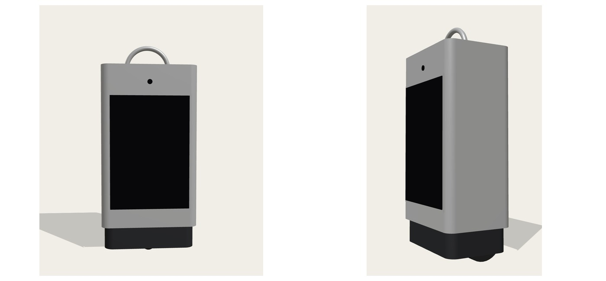
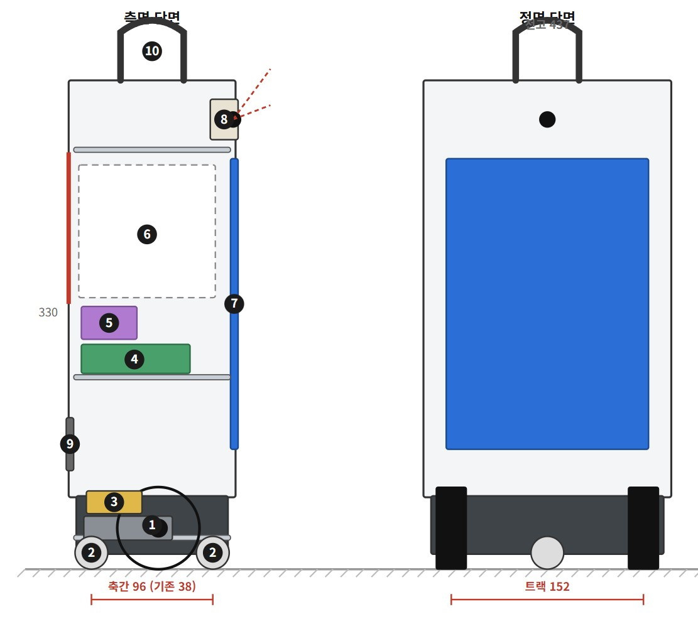
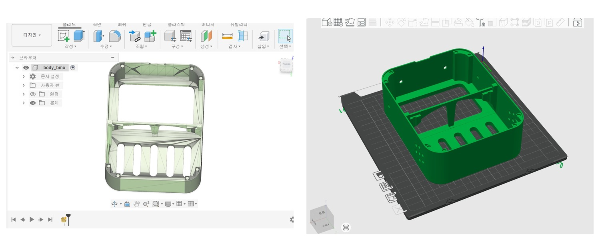
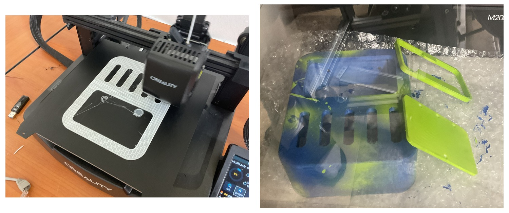
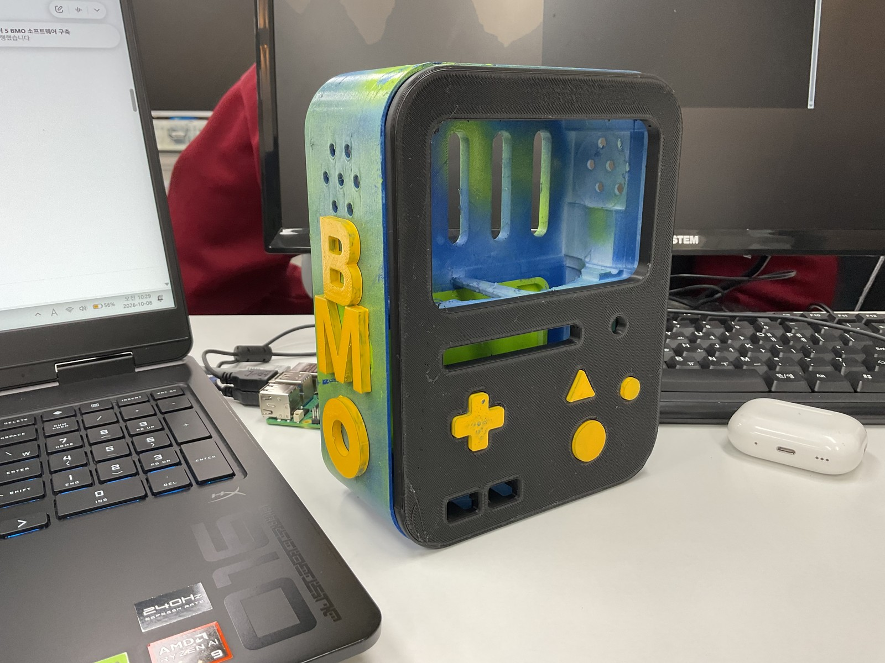
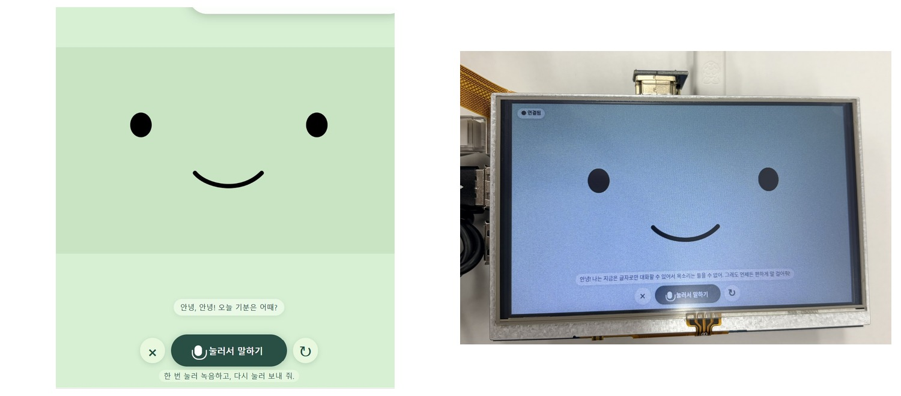
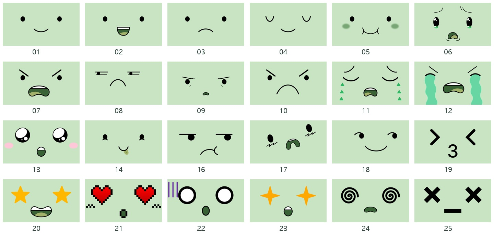
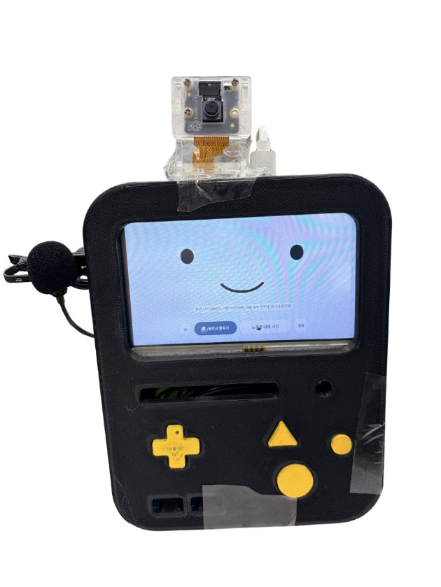

# BMO 개인 AI 비서 제작과 개발 과정

최승빈 · 2026년 10월 22일

이 보고서는 BMO 형태의 장치에 화면·음성·카메라를 연결하면서 만난 문제와 선택을 기록한다. 참고 영상을 보고 시작했지만, 실제 부품의 차이와 사용 중의 불편이 다음 설계를 결정했다. 최종 결과는 라즈베리파이 5에서 웹 서버와 얼굴 화면을 실행하고, 외부 AI API로 대화와 이미지 분석을 처리하는 고정형 시제품이다.

제공된 완성본 사진을 나란히 배치했다. 본문의 제작 사진과 코드는 실제 자료를 사용하며, 초기 구상과 현재 구현을 구분해 설명한다.

<!-- pagebreak -->

## 시작은 BMO 영상 한 편이었다

우연히 BMO를 개인 AI 비서로 만드는 영상을 보았다. 나는 여기에 카메라를 붙이면 어떨지 생각했다. 말로 설명한 내용만 답하는 장치에서, 내가 있는 공간을 함께 보고 이야기할 수 있는 장치로 발전시키고 싶었다.

대화 방식도 바꾸고 싶었다. 눌러서 말하기에서 출발하더라도 매번 버튼을 누르지 않고 실시간으로 주고받고, 더 나아가 주변 상황을 보고 먼저 말을 건다면 내가 생각한 개인 비서에 가까워질 것 같았다. 카메라, 실시간 대화, 프로액티브 기능은 이 생각에서 이어졌다.

처음에는 사용자를 따라가는 이동형 로봇도 구상했다. 초기 외형과 내부 배치에는 바퀴와 모터가 남아 있다. 하지만 이번 제작에서는 고정형 BMO에서 화면·음성·카메라의 연결을 먼저 완성하는 쪽으로 범위를 좁혔다.

초기 기구 구상이다. 이 도면의 형태나 이동부가 최종 시제품에 그대로 구현된 것은 아니다.

초기 배치를 남기는 이유는 처음 계획과 현재 결과가 어떻게 달라졌는지 보여 주기 위해서다.

<!-- pagebreak -->

## 설계 자료가 있어도 실제 부품은 달랐다

가장 오래 고민한 것은 인터넷에서 받은 설계도와 내가 가진 자원이 다르다는 점이었다. 5인치 디스플레이를 쓴다는 조건은 같았지만, 파이의 종류와 USB 선이 차지하는 공간은 같지 않았다. 보드만 놓아 보면 들어가던 공간도 플러그를 꽂으면 부족해졌다.

Fusion에서 구조를 확인하고 출력 준비를 진행한 뒤 실제 부품으로 조립을 이어 갔다. 이 과정에서 화면 크기만 맞추는 것으로는 충분하지 않다는 문제가 드러났다. 디스플레이와 파이 사이의 간격, 커넥터가 나오는 방향, 케이블이 휘는 자리도 본체의 공간을 사용했다.

제공된 Fusion 화면과 슬라이서 화면이다. 참고 자료를 실제 출력과 배치로 옮기는 단계다.

출력 부품을 도색하고 조립했다. 소프트웨어가 실행되는 것과 하드웨어 안에 들어가는 것은 각각 해결해야 하는 문제였다.

<!-- pagebreak -->

## USB 선이 들어갈 자리를 직접 만들었다

USB 마이크와 스피커를 연결하려면 케이블을 꽂은 상태로 본체가 닫혀야 했다. 실제 파이와 디스플레이를 배치하니 설계에서 예상한 공간과 차이가 났다. 내가 가장 기억하는 작업은 인두기로 본체 일부를 직접 가공해 케이블 공간을 확보한 일이다.

이 경험을 프로젝트 과정에서 중요하게 남기고 싶다. 받은 설계 자료를 그대로 출력하는 것으로 끝나지 않았고, 가진 부품에 맞게 손으로 구조를 바꿔야 했다. 화면과 파이 사이 간격, USB 플러그와 선의 공간을 실제로 확인하면서 조립을 이어 갔다.

제공된 조립 사진이다. 인두 가공 순간의 사진은 별도로 남아 있지 않으므로 이 사진을 가공 장면으로 설명하지 않는다.

다시 설계한다면 보드 외곽 치수와 함께 케이블을 꽂은 상태의 공간부터 확인할 것이다. 나중에 부품을 바꾸거나 빼낼 수 있는지도 초기 배치에서 확인할 항목으로 남겼다. 이 개선안은 이번 조립에서 겪은 문제를 바탕으로 한 다음 설계 방향이다.

<!-- pagebreak -->

## 휴대폰이 들어가지 않아 화면 방식을 바꿨다

처음에는 휴대폰을 BMO 내부에 놓고 웹 화면과 음성 입출력에 활용하려 했다. PC 브라우저와 아이패드에서도 화면을 시험했지만, 실제 휴대폰 크기가 본체 공간과 맞지 않았다. 결국 MPI5008 5인치 LCD와 파이의 USB 마이크·스피커를 사용하는 구조로 바꾸었다.

이미 만든 웹 화면은 계속 사용할 수 있었다. 파이의 Chromium에서 같은 페이지를 전체 화면으로 열었다. 그래서 화면 주소에는 초기 이름인 `/phone`이 남아 있지만 최종 장치에 휴대폰이 꼭 필요한 것은 아니다.

왼쪽은 초기 휴대폰용 화면, 오른쪽은 파이에 연결한 LCD 시험 사진이다. 두 사진은 서로 다른 개발 단계다.

바탕화면이 보인 뒤에도 터치는 되지 않았다. HDMI 화면 출력과 GPIO 터치 입력을 나누어 확인하고 기존 화면·카메라 설정을 보존하는 설정 도구를 적용했다. 터치가 된 뒤에는 모서리 버튼을 누르기 어려운 문제가 남아 실시간 대화 시작 버튼을 눌러서 말하기 옆 중앙으로 옮겼다.

이 변경은 기능을 새로 추가하는 것만큼 사용 위치도 중요하다는 사례였다. 작은 화면에서 직접 손으로 조작하면서 버튼 위치와 음량 설정을 보완했다.

<!-- pagebreak -->

## 서버는 어디에서 실행되는가

초기에는 PC에서 서버를 열고 다른 기기가 접속하는 시험을 했다. 이후 파이에서 서버와 얼굴 화면을 함께 실행하는 구조로 정리했다. 파이의 인터넷과 API 설정이 준비되어 있으면 PC 없이도 대화할 수 있다. PC는 개발·설정 변경과 관리자 화면 확인에 사용한다.

USB 입력과 화면은 파이에 있고, AI 계산은 외부 API가 수행한다. PC의 SSH 관리 경로는 선택 사항이다.

처음에는 PC와 파이가 연결되었다는 사실, 다른 기기에서 웹 화면이 열리는 조건, AI API가 호출되는 조건을 혼동하기 쉬웠다. 유선 연결로 파이에 접속할 수 있어도 파이의 인터넷까지 정상이라는 뜻은 아니다. 반대로 파이 IP가 바뀌어 PC 관리 접속이 끊겨도 파이 자체의 인터넷과 서버가 정상이면 장치 대화는 가능하다.

이 구조를 정리하면서 파이의 현재 IP는 PC 관리 경로의 문제로, API 인증과 인터넷·통신 상태는 AI 요청의 문제로 따로 확인하게 되었다. 초기 무선 연결 실패의 정확한 원인은 기록만으로 확정하지 않았다.

현재 구성은 파이 안에서 대형 언어 모델을 실행하는 방식이 아니다. 원형을 참고하면서도 기존 브라우저와 외부 AI API를 계속 활용하겠다는 방향을 유지했다.

<!-- pagebreak -->

## 실시간 대화와 호출어는 다른 요구였다

내가 원한 자동 시작은 “시리야”처럼 부르면 대화가 시작되는 방식이었다. 한때 추가한 자동 대화 실험은 그 의도와 맞지 않아 별도 버전으로 보관하고 되돌렸다. 생각하는 표정과 “생각 중 …” 표시는 남겼다. 이후 실시간 대화 버튼을 복원해 세션을 한 번 시작한 뒤 계속 주고받도록 했다. 호출어는 아직 구현하지 않았다.

한국어 음성 노을을 쓰는 GPT-Live-1 버전도 기존 버전과 분리해 준비했다. 현재는 Live 음성 대화와 별도 이미지 분석 백엔드를 연결한다. Live 음성 프런트엔드에 이미지를 직접 넣는 구조가 아니라는 점은 공식 위임 문서와도 맞춰 확인했다. [OpenAI 위임 문서](https://developers.openai.com/api/docs/guides/live-delegation#add-images-and-visual-context)

주변 사람의 소리에 BMO의 말이 끊기는 문제에는 마이크에 가까이 대고 말하는 사용 방식에 맞춰 입력 크기와 지속 시간을 이용하는 필터를 적용했다. 시작은 일정한 크기로 판단하되, 열린 뒤에는 약한 후속 음절을 유지하도록 조건을 나누었다.

실제 `bmo/web/mic-focus-core.js` 18~23행 발췌다. 전체 코드는 저장소와 핵심 코드 해설에서 확인할 수 있다.

입력 앞부분을 보존하는 약 180ms 버퍼도 사용한다. 소음을 줄이면서 내 말의 첫 음절과 약한 뒷말을 함께 살려야 했기 때문이다. 이 필터는 화자 인증이 아니므로 큰 주변 목소리는 통과할 수 있다. 실제 소음 환경의 비교 시험은 더 필요하다.

<!-- pagebreak -->

## 많은 표정을 실제 대화에서 보고 싶었다

표정 데이터는 많았지만 몇 가지 상태만 반복해서 보이는 것이 아쉬웠다. 나는 BMO가 말하는 문장의 감정을 정해 둔 목록의 한 단어로 분류하고, 한 감정에 여러 표정을 연결해 그중 하나를 선택하도록 요청했다. 동시에 표정이 너무 자주 바뀌지는 않았으면 했다.

Rosto 1~25번 중 15번을 제외한 실제 후보 목록이다. 이 그림은 현재 사용 범위로 새로 구성했다.

실제 `bmo/web/emotions.js` 3~14행이다. 12개 감정별 후보를 두고 직전 이미지와 같은 후보를 제외한 뒤 선택한다.

한 답변 동안 선택한 포즈를 유지하고, 대기·듣기·생각 중 상태는 별도로 처리했다. 감정 표현을 늘리는 것과 처리 상태를 알아보기 쉽게 유지하는 것을 함께 고려한 설계다. 여기서 감정은 답변 문장의 표현을 분류한 값이며 카메라 속 사람의 감정을 판단한 값이 아니다.

<!-- pagebreak -->

## 먼저 말하게 하려면 말하지 않을 조건도 필요했다

카메라를 질문할 때만 쓰기보다 대기 중에도 주변을 관찰하는 방향을 선택했다. 이후에는 상황을 기억하는 데 그치지 않고 더 프로액티브하게 먼저 말을 거는 방향으로 수정했다. 하지만 모든 변화에 반응하면 대화를 방해할 수 있었다.

로컬에서 약 1초 간격으로 사진을 확인하고 안정된 변화 등을 별도 AI로 분석한다. 분석은 최소 30초 간격과 시간당 30회 한도, 공통 예산 제한을 적용한다. 같은 장면을 너무 오래 쓰지 않도록 120초 갱신 기준도 두고 최근 요약은 최대 15분 범위로 관리한다. 로컬 샘플 모두를 API에 보내지는 않는다.

먼저 말하기에는 추가 조건을 둔다. 최초 관찰, 같은 장면, 단순 조명 변화는 안내하지 않는다. 대화가 4초 이상 조용하고 다른 요청이 없을 때만 전달하며, 3분 간격과 시간당 6회 제한을 둔다. 새 발화나 장면 변경, 일시정지, 20초 만료 뒤에는 늦은 안내를 버린다.

실제 `bmo/observation.py` 227~231행 발췌다. 이 조건 외에도 세션·장면·요청 유효성을 확인한다.

실시간 대화 중에는 같은 노을 세션으로 안내하고 별도 TTS를 겹쳐 재생하지 않도록 구성했다. 여러 정지 사진과 최근 요약을 쓰는 방식이며 연속 동영상 전체를 이해하는 기능은 아니다. 조건 제어는 자동 검사했지만 실제 생활에서 언제 말해야 유용한지는 장시간 사용으로 확인할 부분이다.

<!-- pagebreak -->

## 사진을 다시 찍었는데 왜 같은 말을 했을까

마지막으로 직접 요청한 문제는 사진을 다시 찍어 달라고 해도 예전 장면으로 같은 말을 반복한다는 것이었다. 카메라가 연결되었는지만 확인해서는 해결되지 않았다. 새 사진 요청이 들어왔을 때 어떤 프레임과 과거 설명이 분석에 포함되는지를 따져야 했다.

기존 경로에는 관찰 버퍼, 준비한 업로드 사진, 이전 장면 요약이 있었다. 이 자료는 대기 관찰에는 도움이 되지만 명시적으로 “새로 찍어 줘”라고 한 요청에서는 이전 장면을 끌고 올 수 있었다. 카메라 내부에 이미 대기 중인 프레임도 새 촬영처럼 취급하지 않도록 해야 했다.

실제 `bmo/camera.py` 61~67행이다. 요청한 프레임은 처리 뒤 `finally`에서 반환한다.

Picamera2 설명서의 flush 동작을 참고해 `capture_request(flush=True)`를 사용했다. 이 호출 이후 노출을 시작한 프레임을 받기 위한 선택이다. [Picamera2 설명서 6.4.1](https://datasheets.raspberrypi.com/camera/picamera2-manual.pdf)

사진 요청을 인식하면 새 촬영을 하고 촬영 번호와 시각을 갱신한다. 배경 관찰을 꺼 놓았더라도 명시적으로 요청한 한 장은 촬영하며, 배경 관찰은 자동으로 켜지 않는다. 새 촬영이 실패하면 과거 사진으로 성공한 것처럼 답하지 않게 했다.

<!-- pagebreak -->

## 새 사진만 쓰고 늦은 결과는 버리기

새 사진이 있어도 이전 대화나 관찰 설명을 함께 넣으면 답변이 옛 장면을 따라갈 수 있었다. 그래서 명시적 새 촬영 분석에는 새 사진 한 장과 촬영 시각만 사용하고, 과거 이력과 관찰 문맥은 비웠다. 이 처리는 사진 요청의 분석 입력에 적용하며 대화 세션 전체를 삭제하는 뜻은 아니다.

실제 `bmo/live.py` 322~325행이다. 바로 앞에서 새 프레임을 얻은 뒤 이 입력을 구성한다.

촬영과 분석은 즉시 끝나지 않는다. 그동안 사용자가 다른 말을 하거나 세션을 끝낼 수 있다. 결과가 늦게 돌아오면 새 요청에 섞이지 않도록 촬영 전후의 요청·세션 상태를 확인하고 관찰 버퍼를 바꾸기 직전에도 유효성을 확인했다.

실제 `bmo/app.py` 233~246행 발췌다. 유효한 새 촬영만 최신 사진으로 발행한다.

모델이 촬영을 수락하는 말만 하고 위임을 빠뜨리는 경우에는 서버의 신뢰된 자막으로 요청을 확인한다. 같은 요청의 중복 위임은 한 촬영으로 합친다. 이 과정에서 마이크 상태 갱신과 자막의 순서 번호가 섞이는 문제도 회귀 검사로 다뤘다. 모델의 지시문과 서버가 보장하는 처리를 함께 정리한 수정이었다.

<!-- pagebreak -->

## 무엇을 확인했고 무엇이 아직 남았는가

2026년 10월 22일 최종 검증 기록에는 PC·파이 Python 141개, PC JavaScript 61개 통과가 남아 있다. 새 촬영 관련 검사에는 부정 표현, 캐시 배제, 실패 시 처리, 중복 위임, 촬영 중 취소와 자막·마이크 경합 등이 포함된다. 개수 자체를 기능 정확도로 해석하지는 않았다.

실제 파이 카메라와 노을 세션에도 고정 합성 문장을 두 번 보냈다. 촬영 번호가 1에서 2로 바뀌었고 시각은 한국 시간 10시 24분 36초와 56초로 달랐다. 각 요청에서 분석 1회와 결과 전달, 정상 종료를 확인했다. 실제 내 목소리로 모든 상황을 시험한 것은 아니다.

첫 음성 응답에는 새 결과 전달 전 짧은 설명 조각도 있었다. 서버가 새 사진을 사용한다고 해서 모델의 모든 발화가 완벽해졌다고 말할 수는 없다. 새 이미지의 사용과 과거 캐시 배제, 음성 표현의 자연스러움은 나누어 확인할 문제로 남겼다.

기능 시험과 별도로 남아 있는 실제 제작 결과다. 이 사진 한 장이 모든 기능의 성공을 증명하는 것은 아니다.

이전 버전 10개는 보관되어 있다. 자동 대화 실험, 수동 대화 복원, 음량 설정, 표정, 관찰, 노을, 최종 새 사진 처리 순서로 변경 기록을 추적할 수 있다. 자세한 날짜는 개발일지와 검증 문서에 남겼다.

<!-- pagebreak -->

## 내가 맡은 일과 AI의 도움

나는 만들고 싶은 BMO의 방향과 기능의 우선순위를 정했다. 직접 기구 설계와 출력 준비, 도색, 부품 조립과 배선을 진행했다. 카메라 포트와 실제 표기를 확인하고, 터치와 스피커를 시험하고, 인두기로 공간을 확보했다. 사용 중 반복되는 사진 설명과 주변 소리에 끊기는 문제도 직접 전달했다.

초기 기획과 문서 초안에는 Claude를, 이후 구현과 설정 지원에는 ChatGPT와 Codex를 활용했다. AI는 코드 작성·수정, 오류 원인 분석, 원격 설정과 자동 검사, 문서 편집을 도왔다. 모든 코드를 혼자 작성한 것처럼 기록하지 않고, 직접 수행한 작업과 도움받은 작업을 구분한다.

이 프로젝트에서 내가 남기고 싶은 과정은 부품과 코드를 연결한 선택들이다. 휴대폰이 들어가지 않자 LCD로 바꾸면서 웹 화면은 유지했고, 자동 시작 실험이 원한 방식과 다르자 버전으로 남긴 뒤 되돌렸다. 많은 표정은 답변 감정과 연결하되 기본 상태 표시를 지켰다. 카메라는 연결 성공 다음에 촬영 시점과 분석 입력을 다시 다뤄야 했다.

가장 기억에 남는 장면은 여전히 본체의 공간을 직접 만든 작업이다. 화면 크기가 같아도 내가 가진 파이와 USB 케이블을 넣으려면 구조가 달라져야 했다. 이 경험과 사진 갱신 문제를 함께 돌아보면, 다음 제작에서는 실제 부품의 공간과 실제 데이터가 생성된 시점을 더 일찍 확인하고 싶다.

다음 단계는 실제 소음 속 발화 비교, 프로액티브 안내의 장시간 평가, 전원·네트워크 복구 시험이다. 호출어와 이동 기능은 그 뒤의 별도 과제로 남긴다. 지금 결과의 범위를 정확히 남기는 것이 다음 버전을 시작할 기준이 된다.

<!-- pagebreak -->

## 자료와 기록을 읽는 방법

이 보고서는 기존 수행평가 문서의 사진과 일지, 실제 BMO 소스, 버전·검증 기록, 개발자가 추가로 제공한 설명을 바탕으로 만들었다. 수행평가 양식의 항목을 다시 채우기보다 각 문제에서 왜 방향을 바꿨는지를 중심으로 재구성했다. 원본 보고서와 원본 사진은 수정하지 않았다.

새 코드 이미지는 설치된 CodeSnap 1.3.4 렌더러의 PNG 내보내기로 만들었다. 코드 이미지에는 실제 파일 경로와 줄 번호를, 별도 목록에는 SHA-256을 기록했다. [핵심 코드 해설](KEY_CODE.md)에는 같은 발췌를 복사할 수 있는 텍스트도 함께 넣었다. 발췌 조각만으로 실행되는 예제는 아니다.

사진은 초기 계획, 참고 외형, 제작 과정, 당시 시험 화면, 최종 시제품을 구분했다. 참고 외형을 내가 만든 결과로 사용하지 않았다. 인두 가공 순간의 사진과 실제 개인 대화·카메라 원시 자료는 이 보고서에 없다. 상세 출처는 [사진 출처와 참고 자료](CREDITS.md)에 모았다.

주요 참고 자료는 다음과 같다.

- [제작 계기가 된 BMO 영상](https://www.youtube.com/watch?v=l5ggH-YhuAw)
- [Raspberry Pi 카메라 문서](https://www.raspberrypi.com/documentation/computers/camera_software.html)
- [Picamera2 설명서](https://datasheets.raspberrypi.com/camera/picamera2-manual.pdf)
- [LCDWiki 5inch HDMI Display](https://www.lcdwiki.com/5inch_HDMI_Display)
- [OpenAI GPT-Live 1](https://developers.openai.com/api/docs/models/gpt-live-1)
- [OpenAI Live 세션과 음성](https://developers.openai.com/api/docs/guides/live-conversations)
- [OpenAI Live 위임과 시각 문맥](https://developers.openai.com/api/docs/guides/live-delegation)

기술 문서는 2026년 10월 22일 확인했다. 기능 상태와 시험 결과는 해당 시점의 프로젝트 기록이며 이후 모델·API 변경과 장기 실사용 평가까지 포함한 결론은 아니다.
